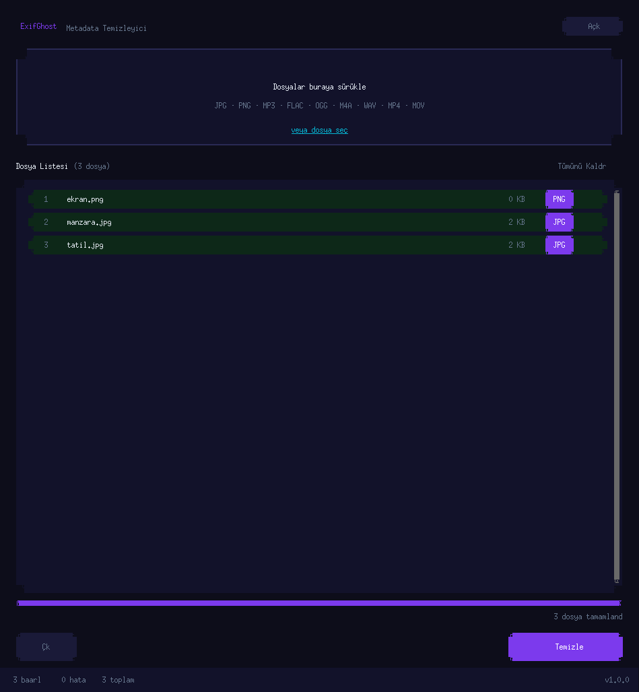

# 👻 ExifGhost

Fotoğraf, ses ve video dosyalarındaki metadata'yı tek tıkla temizleyen masaüstü uygulaması. İşlem tamamen yereldir, hiçbir veri dışarı çıkmaz.

| Dosyalar eklendi | Temizleme bitti |
|---|---|
|  |  |

## Özellikler

- Sürükle-bırak veya dosya seçici ile çoklu dosya ekleme
- Temiz kopya orijinalin yanına `_cleaned` son ekiyle kaydedilir, orijinal dosya değiştirilmez. Aynı adlı bir `_cleaned` dosyası zaten varsa üzerine yazılmaz; `_cleaned (2)`, `_cleaned (3)` gibi numaralandırılır
- Dosya başına durum ve genel ilerleme çubuğu (arka plan iş parçacığında çalışır); hata ve atlanan dosyaların nedeni bitiş özetinde gösterilir
- Açık / koyu tema

## Neyi siler, neyi silmez?

| Tür | Formatlar | Yöntem | Silinenler | Korunanlar |
|---|---|---|---|---|
| Görsel | JPG, JPEG | Pillow ile yeniden kayıt (kalite 95) | EXIF (GPS dahil), XMP, IPTC/Photoshop, COM yorum segmenti | ICC renk profili; EXIF yönü (Orientation) piksellere uygulanır, görüntü yan dönmez |
| Görsel | PNG, APNG | Pillow ile yeniden kayıt | tEXt/zTXt/iTXt (XMP dahil), eXIf, dpi vb. | ICC renk profili, saydamlık; animasyonlu PNG'de tüm kareler, süreler ve döngü sayısı |
| Ses | MP3, FLAC, OGG, M4A, AAC | mutagen ile etiketlerin silinmesi | ID3/Vorbis/MP4 etiketleri | Ses verisi (yeniden kodlanmaz) |
| Ses | WAV | RIFF dosyası yeniden yazılır | `LIST/INFO`, `id3 `, `bext`, `iXML`, XMP vb. tüm ek chunk'lar | Yalnızca `fmt `, `fact`, `data`; ses verisi birebir |
| Video | MP4, MOV, M4V | **ffmpeg** ile akış kopyalama (`-c copy`) | Konteyner ve akış etiketleri (GPS `location` dahil), bölümler, kapak görseli, zamanlı veri akışları | Video/ses/altyazı akışları (yeniden kodlanmaz, kalite kaybı olmaz) |

Önemli notlar:

- **JPEG yeniden kodlanır:** EXIF'i güvenle atmak için görüntü kalite 95 ile yeniden sıkıştırılır; bu işlem kayıplıdır, küçük bir kalite kaybı olabilir. PNG kayıpsızdır.
- **ICC renk profili kasıtlı olarak korunur;** silinirse renkler değişir. Profil kişisel bilgi taşımaz, ancak çok nadir de olsa cihaz/yazılım adı içerebilir.
- **Video ve ffmpeg:** MP4/MOV/M4V temizliği için `ffmpeg` (ve raporlama için `ffprobe`) PATH'te kurulu olmalıdır. Kurulu değilse bu dosyalar "hata" olarak işaretlenir ve çıktı üretilmez; başarı bildirilmez. Görsel, MP3/FLAC/OGG/M4A/AAC ve WAV için ffmpeg gerekmez.
- Çıktı yeni bir dosya olarak yazılır: dosya sistemi xattr'ları ve eski tarihler taşınmaz. **Dosya adının kendisi** kişisel bilgi içeriyorsa onu elle değiştirmelisiniz.
- Görüntü pikselleri, ses/video içeriği ve gömülü filigranlar (steganografi, görünür damga vb.) bu araçla temizlenmez.

## Kurulum

Python 3.10+ ve Tk gerekir (bazı Linux dağıtımlarında ayrıca `tk` paketi).

```bash
git clone https://github.com/Shidori5417/ExifGhost.git
cd ExifGhost
python -m venv venv
source venv/bin/activate      # Windows: venv\Scripts\activate
pip install -r requirements.txt
python main.py
```

Video temizliği için ffmpeg (isteğe bağlı bağımlılık): `sudo apt install ffmpeg`, `brew install ffmpeg` veya Windows'ta `winget install ffmpeg`.

## Test

```bash
pip install -r requirements-dev.txt
ruff check .
pytest
```

Testler ekran gerektirmez. ffmpeg kurulu değilse video testleri atlanır.

## Teknoloji ve yapı

`customtkinter` (arayüz), `tkinterdnd2` (sürükle-bırak), `Pillow` + `piexif` (görsel), `mutagen` (ses), `ffmpeg` (video, isteğe bağlı).

```
main.py    # giriş noktası
gui.py     # CustomTkinter arayüzü
logic.py   # format bazlı temizleyiciler (clean_file)
tests/     # pytest testleri
```

## Lisans

[MIT](LICENSE)
