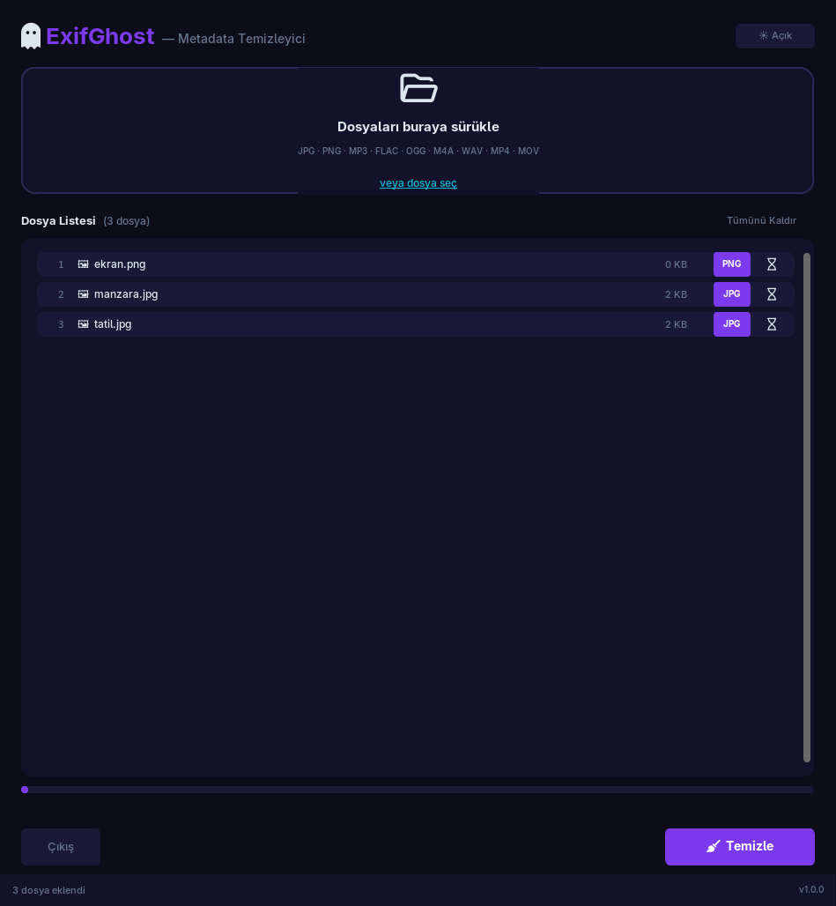
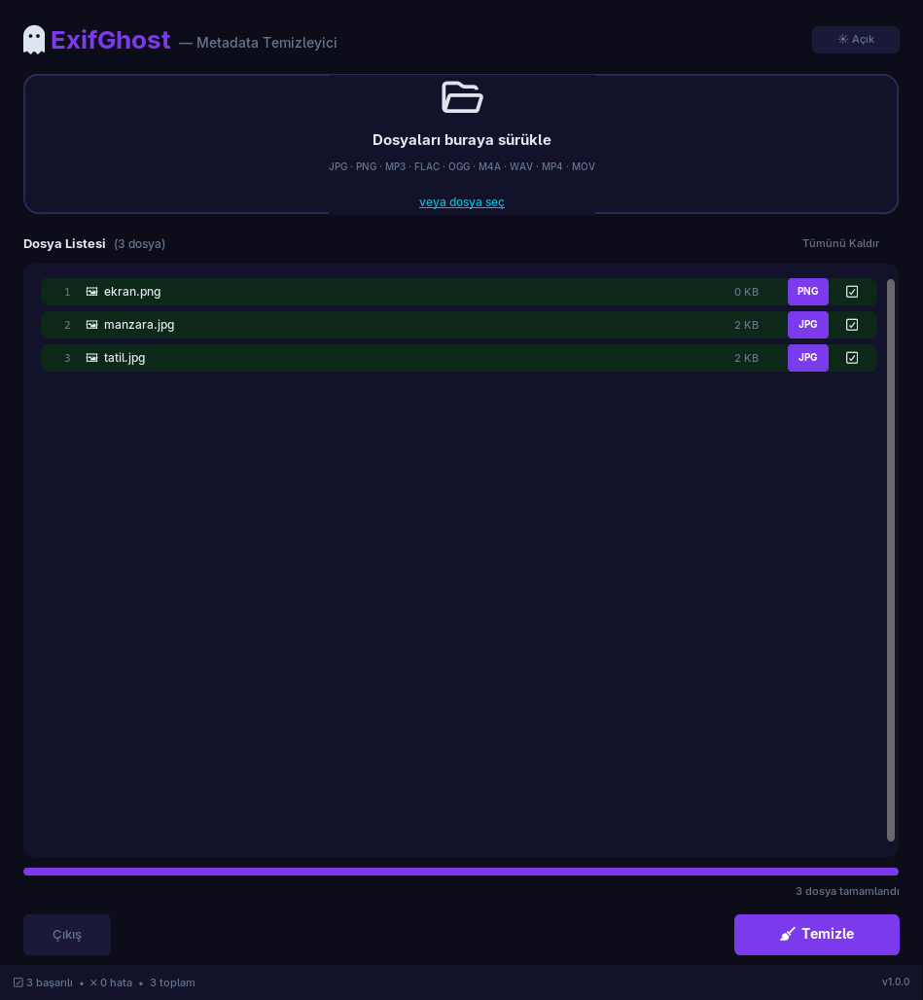

# 👻 ExifGhost

Fotoğraf, ses ve video dosyalarındaki metadata'yı tek tıkla temizleyen masaüstü uygulaması. İşlem tamamen yereldir, hiçbir veri dışarı çıkmaz.

| Dosyalar eklendi | Temizleme bitti |
|---|---|
|  |  |

## Özellikler

- Sürükle-bırak veya dosya seçici ile çoklu dosya ekleme
- Temiz kopya orijinalin yanına `_cleaned` son ekiyle kaydedilir, orijinal dosya değiştirilmez
- Dosya başına durum ve genel ilerleme çubuğu (arka plan iş parçacığında çalışır)
- Açık / koyu tema

| Tür | Formatlar | Yöntem |
|---|---|---|
| Görsel | JPG, JPEG, PNG | Pillow ile EXIF/metadata'sız yeniden kayıt (JPEG kalite 95) |
| Ses | MP3, FLAC, OGG, M4A, AAC, WAV | mutagen ile etiketlerin silinmesi |
| Video | MP4, MOV, M4V | mutagen ile etiketlerin silinmesi |

## Kurulum

Python 3.10+ ve Tk gerekir (bazı Linux dağıtımlarında ayrıca `tk` paketi).

```bash
git clone https://github.com/Shidori5417/ExifGhost.git
cd ExifGhost
python -m venv venv
source venv/bin/activate      # Windows: venv\Scripts\activate
pip install -r requirements.txt
python main.py
```

## Teknoloji ve yapı

`customtkinter` (arayüz), `tkinterdnd2` (sürükle-bırak), `Pillow` + `piexif` (görsel), `mutagen` (ses/video).

```
main.py    # giriş noktası
gui.py     # CustomTkinter arayüzü
logic.py   # format bazlı temizleyiciler (clean_file)
```

## Lisans

[MIT](LICENSE)
